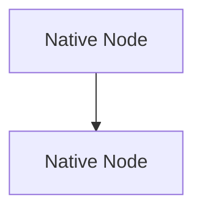

# Obsidian Mermaid Genie

[](LICENSE)
[]()
[](https://obsidian.md)
[]()

**Mermaid Genie** is an advanced, high-performance Obsidian plugin engineered for publication-quality Mermaid diagrams. It combines Obsidian's native **Pele** compiler (<1ms synchronous render time) with a resilient **Mermaid.js** fallback, intelligent layout compaction, branch-aligned connectors, interactive upstream path illumination, harmonious branch color palettes, and distortion-free typography across all 33 Mermaid diagram types.

Developed and maintained by **Vibish** ([@VibishnathanG](https://github.com/VibishnathanG)).

---

## Table-of-Contents

- [Core Capabilities](#Core-Capabilities)
- [Dual Engine Architecture](#Dual-Engine-Architecture)
- [Specialized Diagram Cosmetics](#Specialized-Diagram-Cosmetics)
- [Future Pele Upgrades](#Future-Pele-Upgrades)
- [Palettes and Theming](#Palettes-and-Theming)
- [Interactive Controls & Export](#Interactive-Controls-and-Export)
- [Installation](#Installation)
- [Configuration](#Configuration)
- [Development and Testing](#Development-and-Testing)
- [License](#License)

---

## Core-Capabilities

- **Dual-Engine Architecture (Pele + Mermaid.js)**:
  - Primary: Obsidian's official **Pele** compiler (<1ms render latency, synchronous zero-flicker rendering, up to 500x faster).
  - Fallback: Resilient **Mermaid.js v12+** engine with zero-interruption error recovery.
- **Harmonious Multi-Colored Flow Blocks**:
  - Automatically identifies parallel decision branches, subgraphs, and execution paths.
  - Assigns coordinated 6-slot palette tones (`Clear`, `Cool`, `Natural`) or single-hue presets (`Slate`, `Mint`, `Sky`, `Rose`, `Custom`).
- **Interactive Ancestor Path Highlighting**:
  - Hover or keyboard-focus any node or edge to illuminate its full upstream workflow.
  - Non-path elements smoothly dim with hardware-accelerated transitions.
- **Diagram Zoom & Fullscreen Viewer**:
  - Floating zoom controls (+, -, reset) on every diagram block.
  - One-click 4-bracket fullscreen modal with pan and zoom.
- **Export & Clipboard Suite**:
  - One-click copy as clean vector SVG or high-DPI PNG.
  - Direct export to Obsidian vault attachments or local system directories.
- **Extended & Transpiled Diagram Syntaxes**:
  - ZenUML, UseCase-beta, AgentFlow-beta, TreeView-beta, Cynefin-beta, Wardley-beta, and Railroad-beta.
- **WCAG AA Compliance**:
  - Enforces minimum 4.5:1 contrast ratios on all text and labels across both light and dark themes.

---

## Dual-Engine-Architecture

Mermaid Genie features a resilient dual-engine rendering pipeline:

```text
               ┌──────────────────────────────┐
               │    Mermaid Diagram Source    │
               └──────────────┬───────────────┘
                              │
                    Pre-transpile & Sanitize
                              │
               ┌──────────────▼───────────────┐
               │  Pele Compiler (Primary)     │
               │  Synchronous, <1ms render    │
               └──────────────┬───────────────┘
                              │
                Success? ─────┴───── Fallback?
                   │                    │
                  YES                   NO
                   │                    │
        ┌──────────▼──────────┐ ┌───────▼───────────┐
        │  enhancePeleSvg()   │ │ Mermaid.js v12    │
        │  Genie CSS Vars &   │ │ + styleSvg()      │
        │  Multi-color branch │ │ 6-Diagram Tweaks  │
        └──────────┬──────────┘ └───────┬───────────┘
                   │                    │
                   └──────────┬─────────┘
                              │
                    ┌─────────▼─────────┐
                    │ True LRU Cache    │
                    │ 0ms instant reload│
                    └─────────┬─────────┘
                              │
                    ┌─────────▼─────────┐
                    │ Obsidian DOM View │
                    └───────────────────┘
```

1. **Pele Engine**: Obsidian's official Rust/Wasm-based Mermaid compiler. Runs synchronously with zero layout shift and maps Genie's active theme palette directly to Pele's native `--pele-*` CSS variables.
2. **Mermaid.js Fallback**: Seamlessly handles advanced or extended diagram types with specialized SVG post-processing and auto-sanitization.
3. **In-Memory LRU Cache**: Zero-latency re-renders when navigating back and forth between notes in Obsidian.

---

## Specialized-Diagram-Cosmetics

Mermaid Genie provides dedicated cosmetic post-processing for the following diagram types:

### D11-Requirement-Diagram
- **Auto-Sanitized Verification Methods**: Automatically corrects non-standard verification tokens (e.g. `benchmark` or `automated_test`) to standard SysML tokens (`analysis`, `demonstration`, `inspection`, `test`), eliminating parser crashes.
- **Thematic Containers & Badges**: Enhances requirement boxes with `palette.surface` fills, `palette.border` strokes, and dedicated `<<Element>>` styling.
- **Padded HTML Labels**: Applies internal horizontal padding to ID, Text, Risk, and Verification rows to eliminate border collisions.

### D04-Class-Diagram
- **Member & Method Padding**: Insets class attribute and method labels with 10px left padding, preventing symbols like `+String make` and `+startEngine() void` from touching the left container border.
- **Crisp Dividers & Centered Titles**: Formats class headers and dividers with 6px corner rounding, high-contrast bold titles, and clean divider strokes.

### D06-Entity-Relationship-Diagram
- **Attribute Inset Breathing Room**: Provides 8px horizontal padding on attribute types, names, and keys (`paddingLeft: 8px`), eliminating text collisions against the outer border and vertical dividers.
- **Key Highlighting & Alternating Rows**: Highlights `PK` and `FK` badges in `palette.accent` and styles alternating table rows with `palette.surface` and `palette.clusterBkg`.

### D08-Gantt-Chart
- **Dark Mode Outside Text Contrast**: Eliminates Mermaid's default dark charcoal (`#2c2c2c`) on outside task labels and section headers, enforcing bright, legible typography (`!important`) in dark themes.
- **Thematic Task Bars & Milestones**: Distinguishes active tasks (`palette.accent`) and done tasks (`palette.clusterBkg`), and offsets milestone labels by +14px from milestone diamond markers.

### D22-Kanban
- **Card Text Word-Wrapping**: Replaces Mermaid's hardcoded `white-space: nowrap` with `white-space: normal; word-break: break-word;` and 4px 8px padding, preventing card titles from spilling into adjacent columns.
- **Column Header Clearance**: Enforces 20px clearance between column header titles and top cards, preventing overlap.

### D26-Treemap
- **Coordinated Palette Fills**: Replaces muddy dark boxes with vibrant, coordinated fills from `palette.fills` with 5px corner rounding and crisp borders.
- **Vertical Label/Value Separation**: Automatically offsets leaf values by +16px below leaf category labels when rendered at overlapping vertical positions.

---

## Future-Pele-Upgrades

When upgrading Pele in the future, follow this streamlined checklist:

### Step 1: Update the Package
```bash
npm install pele@latest
```

### Step 2: Verify Key Integration Files
- [`src/pele-engine.ts`](src/pele-engine.ts): Check the `peleRender(text, options)` call signature and verify that `--pele-*` CSS variables are intact.
- [`src/main.ts`](src/main.ts): Verify that `renderWithPele` wraps output in a `RenderResult` object `{ svg: peleSvg, bindFunctions: () => {} }` with `.toString()`.
- [`esbuild.config.mts`](esbuild.config.mts): Ensure `pele` is bundled into the output (not marked as external).

### Step 3: Run the Verification Suite
```bash
# Typecheck
npm run typecheck

# Pele and gallery tests
npx tsx --test tests/pele-engine.test.ts
npx tsx --test tests/gallery-verify.test.ts

# Full test suite (70 tests)
npm test
```

### Step 4: Build and Deploy
```bash
npm run build
```
Esbuild compiles `main.js` and automatically syncs the bundle directly into your active Obsidian vault.

---

## Palettes-and-Theming

### Multi-Color-Coordinated-Palettes

| Palette Name | Description | Tones Included | Reference Note |
| :--- | :--- | :--- | :--- |
| **Clear** | Balanced, fresh, and modern | Blue, Teal, Amber, Violet, Cyan, Rose | |
| **Cool** | High-tech and focused | Indigo, Cyan, Violet, Sky, Ocean, Slate | |
| **Natural** | Warm and organic | Sage, Ochre, Terracotta, Olive, Stone, Clay | |

### Single-Hue-Presets

| Preset Name | Light Mode | Dark Mode | Reference Note |
| :--- | :--- | :--- | :--- |
| **Slate** | Clean Slate Gray | Deep Slate Blue | |
| **Mint** | Mint Green Accent | Emerald Green Surface | |
| **Sky** | Radiant Sky Blue | Navy Night Blue | |
| **Rose** | Subtle Rose Quartz | Deep Berry Tint | |

---

## Interactive-Controls-and-Export

Each diagram block is equipped with a non-intrusive floating action overlay:
- **Zoom In / Out / Reset**: Adjusts diagram zoom scale between 0.3x and 3.0x.
- **Fullscreen Modal**: Opens an isolated, distraction-free modal viewer with pan and zoom.
- **Copy SVG**: Copies the sanitized, standalone vector graphic directly to clipboard.
- **Copy PNG**: Renders a high-resolution 2x DPI raster image to clipboard.
- **Save to Vault**: Saves the diagram image directly to your configured vault attachment folder.

### Diagram-Level Opt-Out
To disable Genie enhancements on a specific diagram, add `%% mg:off` or `%% mfe:off` anywhere inside the Mermaid block:



---

## Installation

### Method 1: Local Vault Sync (Development)
The repository build script automatically syncs compiled builds directly to:
```text
/mnt/c/Users/vibis/OneDrive/Documents/Obsidian Vault/.obsidian/plugins/mermaid-genie-local/
```
Simply run:
```bash
npm run build
```
Then reload Obsidian (`Ctrl + R` / `Cmd + R` or **Community plugins → Reload**).

### Method 2: Manual Installation
1. Copy the following files from [`dist/`](dist/):
   - `main.js`
   - `manifest.json`
   - `styles.css`
   - `README.md`
2. In your Obsidian vault, create a folder at `.obsidian/plugins/mermaid-genie/`.
3. Paste the files inside that folder.
4. In Obsidian, navigate to **Settings → Community plugins**, click **Reload plugins**, and toggle **Mermaid Genie** on.

---

## Configuration

All plugin settings can be modified via Obsidian's settings UI or directly edited in `data.json`:

```json
{
  "renderEngine": "pele",
  "colorStyle": "multi",
  "multiPalette": "clear",
  "singlePalette": "slate",
  "compactLayout": true,
  "pathHighlight": true,
  "animationDuration": 450,
  "hoverDelay": 180,
  "nodeRadius": 6,
  "exportControls": true,
  "exportFolder": ""
}
```

For full details on each configuration property, refer to [DATA_OPTIONS.md](DATA_OPTIONS.md).

---

## Development-and-Testing

```bash
# Install dependencies
npm install

# Run the complete automated test suite (70 tests)
npm test

# Run TypeScript typecheck
npm run typecheck

# Build production bundle and sync to vault
npm run build

# Start watch mode for active development
npm run dev
```

---

## License

MIT License — Copyright (c) 2026 [Vibish](https://github.com/VibishnathanG).
