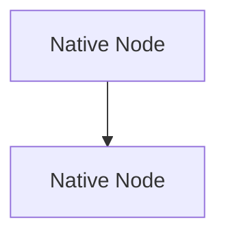

# Obsidian Mermaid Genie

[](LICENSE)
[]()
[](https://obsidian.md)

**Mermaid Genie** is a high-performance Obsidian plugin engineered for beautiful, publication-quality Mermaid diagrams. It combines compact layout intelligence, aligned decision branches, interactive upstream path illumination, harmonious multi-colored flow blocks, and 100% distortion-free typography across all 33 Mermaid diagram types.

Developed and maintained by **Vibish** ([@VibishnathanG](https://github.com/VibishnathanG)).

---

## Core-Capabilities

- **Harmonious Multi-Colored Flow Blocks**: Intelligently identifies branches, subgraphs, parallel paths, and decision trees to assign distinct, coordinated color palettes (`Clear`, `Cool`, `Natural`, or single-hue presets `Slate`, `Mint`, `Sky`, `Rose`).
- **Comprehensive Syntax Support**:
  - **ZenUML Sequences**: Transpiles nested sync execution lifelines, stereotyping annotators (`@Actor`, `@Boundary`, `@Database`), async events, loops, and reply messages without external web dependencies.
  - **Use Case Diagrams**: Native actor boundaries, stereotypes (`<<include>>`, `<<extend>>`), and interaction links.
  - **Block Diagrams (`block-beta`)**: Balanced multi-column grid layouts, 14px crisp arrowheads, and high-contrast typography.
  - **Sankey Diagrams (`sankey-beta`)**: Luminous multi-gradient ribbons (`mix-blend-mode: normal`) and collision-free node labels with 2.5px text halos.
  - **C4 Architecture Diagrams**: Deconflicted relationship labels with protective badge pills and normalized dark-mode contrast.
  - **SysML Requirement Diagrams**: Thematic container fills, clean risk/verification badges, and styled relationship arrows.
  - **Gantt Charts**: High-contrast active task text (`#0f172a` against light accent bars in dark mode) and crisp axis date tick marks.
- **Crisp, Non-Distorted Typography**:
  - Inherits Obsidian's native font stack (`var(--font-text)`).
  - Eliminates Obsidian's dark-mode invert filters that cause color degradation and subpixel blurring.
  - Enforces WCAG AA contrast ratios (>4.5:1) on every node and label.
- **Compact Flowchart Layout & Smart Routing**:
  - Aligns parallel branches leaving decision diamonds.
  - Routes clean orthogonal connectors with rounded corners.
  - Dedicated outer return lanes without connector overlap.
  - Decision diamond label wrapping prevents oversized nodes.
- **Interactive Ancestor Path Highlighting**:
  - Hover or focus any node or edge to illuminate its complete upstream workflow.
  - Non-path elements gently dim with hardware-accelerated transitions.
- **Instant In-Memory Render Cache**:
  - Caches styled SVGs in memory for 0ms re-renders during note navigation.
- **Copy & Export Controls**:
  - Floating action menu directly on diagram blocks.
  - Copy diagram as vector SVG or high-DPI PNG.
  - Export diagram directly into Obsidian vault attachments or system file dialogs.

---

## Installation

### Manual-Installation

1. Copy the following three files from the [`dist/`](dist/) folder:
   - `main.js`
   - `manifest.json`
   - `styles.css`
2. In your Obsidian vault, navigate to:
   ```text
   <vault>/.obsidian/plugins/
   ```
3. Create a folder named `mermaid-genie`:
   ```text
   <vault>/.obsidian/plugins/mermaid-genie/
   ```
4. Place the three files inside that folder.
5. In Obsidian, open **Settings → Community plugins**, click **Reload plugins**, and enable **Mermaid Genie**.

---

## Palettes-and-Theming

### Multi-Color-Coordinated-Palettes

| Palette Name | Description | Tones Included | Reference Note |
| :--- | :--- | :--- | :--- |
| **Clear** | Balanced, fresh, and modern | Blue, Teal, Amber, Violet, Cyan, Rose | |
| **Cool** | High-tech and focused | Indigo, Cyan, Violet, Sky, Ocean, Slate | |
| **Natural** | Warm and organic | Sage, Ochre, Terracotta, Olive, Stone, Clay | |

### Single-Hue-Presets

| Preset Name | Light Mode | Dark Mode | Reference Note |
| :--- | :--- | :--- | :--- |
| **Slate** | Clean Slate Gray | Deep Slate Blue | |
| **Mint** | Mint Green Accent | Emerald Green Surface | |
| **Sky** | Radiant Sky Blue | Navy Night Blue | |
| **Rose** | Subtle Rose Quartz | Deep Berry Tint | |

---

## Opt-Out

If you wish to bypass enhancement on a specific diagram, add the comment `%% mg:off` or `%% mfe:off` anywhere in the Mermaid code block:



---

## Development

```bash
# Install dependencies
npm install

# Run unit test suite (47 tests)
npm test

# Run TypeScript type check
npm run typecheck

# Build production bundle
npm run build
```

---

## License

MIT License — Copyright (c) 2026 [Vibish](https://github.com/VibishnathanG).
