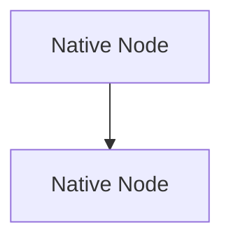

# Mermaid Genie

**Mermaid Genie** is an Obsidian plugin combining compact layout intelligence, aligned decision branching, smooth interactive ancestor path highlighting, coordinated multi-colored flow blocks, crisp non-distorted typography, and comprehensive PNG/SVG export capabilities.

## Overview

Mermaid Genie merges the best architectural features from [obsidian-mermaid-flow-enhancer](https://github.com/itsNikolay/obsidian-mermaid-flow-enhancer) and [mermaid-beauty](https://github.com/theChildinus/mermaid-beauty), addressing the core rendering flaws (such as text distortion and dark-mode color inversion) while establishing a lightweight (~70 KB) native runtime footprint.

### Core-Capabilities

- **Nice Colored Flow Blocks**: Intelligently identifies branches, subgraphs, and clusters to assign distinct, harmonious colors using balanced palettes (`Clear`, `Cool`, `Natural`, or single-hue presets like `Slate`, `Mint`, `Sky`, `Rose`).
- **Crisp, Clear Typography**: Solves the blurry / distorted text issue present in other renderers:
  - Inherits Obsidian's native font stack (`var(--font-text)`).
  - Enforces `filter: none !important;` to neutralize Obsidian's dark-mode invert filter that causes color degradation and subpixel fringing.
  - Dynamically calculates WCAG contrast ratios (`textOnFill`) to guarantee readability (>4.5:1).
  - Uses native HTML labels (`htmlLabels: true`) with clean line-heights and word wrapping.
- **Compact Flowchart Layout**:
  - Aligns parallel branches leaving decision diamonds.
  - Routes clean orthogonal connectors with rounded corners.
  - Handles return loops through dedicated outer lanes without line collisions.
  - Automatically wraps decision diamond labels to avoid excessively wide diamonds.
- **Interactive Ancestor Path Highlighting**:
  - Hover or focus any node or edge to illuminate its complete upstream workflow.
  - Non-path elements gently dim with smooth hardware-accelerated transitions.
- **Copy & Export Controls**:
  - Floating action menu directly on diagram blocks.
  - Copy diagram as vector SVG or high-DPI PNG.
  - Export diagram directly into Obsidian vault attachments or system file dialogs.
  - Command palette integration.

---

## Installation

### Manual-Installation

1. Copy the following three artifacts from this repository:
   - `main.js`
   - `manifest.json`
   - `styles.css`
2. In your Obsidian vault, navigate to:
   `<vault>/.obsidian/plugins/`
3. Create a folder named `mermaid-genie`:
   `<vault>/.obsidian/plugins/mermaid-genie/`
4. Place the three files inside that folder.
5. In Obsidian, go to **Settings → Community plugins**, click **Reload**, and enable **Mermaid Genie**.

---

## Palettes-and-Theming

### Multi-Color-Coordinated-Palettes

| Palette Name | Description | Tones Included | Reference Note |
| :--- | :--- | :--- | :--- |
| **Clear** | Balanced, fresh, and modern | Blue, Teal, Amber, Violet, Cyan, Rose | |
| **Cool** | High-tech and focused | Indigo, Cyan, Violet, Sky, Ocean, Slate | |
| **Natural** | Warm and organic | Sage, Ochre, Terracotta, Olive, Stone, Clay | |

### Single-Hue-Presets

| Preset Name | Light Mode | Dark Mode | Reference Note |
| :--- | :--- | :--- | :--- |
| **Slate** | Clean Slate Gray | Deep Slate Blue | |
| **Mint** | Mint Green Accent | Emerald Green Surface | |
| **Sky** | Radiant Sky Blue | Navy Night Blue | |
| **Rose** | Subtle Rose Quartz | Deep Berry Tint | |

---

## Opt-Out

If you wish to bypass enhancement on a specific diagram, add the comment `%% mg:off` or `%% mfe:off` anywhere in the Mermaid code block:



---

## Development

```bash
# Install dependencies
npm install

# Run unit tests
npm test

# Run TypeScript type check
npm run typecheck

# Build production bundle
npm run build
```
