# Mermaid Syntax Rendering Test Gallery

Comprehensive test file containing sample code blocks for all Mermaid, Pele, and extended diagram syntaxes. Use this file inside Obsidian to verify styling, typography, arrow alignment, badge positioning, and responsive rendering.

## Master-Plan

| Diagram Type | Keyword / Syntax | Anchor Link | Reference Note |
| :--- | :--- | :--- | :--- |
| Flowchart | `flowchart` / `graph` | [D01](#D01-Flowchart) | |
| Swimlanes Diagram | `swimlane-beta` / `subgraph` | [D02](#D02-Swimlanes-Diagram) | |
| Sequence Diagram | `sequenceDiagram` | [D03](#D03-Sequence-Diagram) | |
| Class Diagram | `classDiagram` | [D04](#D04-Class-Diagram) | |
| State Diagram | `stateDiagram-v2` | [D05](#D05-State-Diagram) | |
| Entity Relationship Diagram | `erDiagram` | [D06](#D06-Entity-Relationship-Diagram) | |
| User Journey | `journey` | [D07](#D07-User-Journey) | |
| Gantt Chart | `gantt` | [D08](#D08-Gantt-Chart) | |
| Pie Chart | `pie` | [D09](#D09-Pie-Chart) | |
| Quadrant Chart | `quadrantChart` | [D10](#D10-Quadrant-Chart) | |
| Requirement Diagram | `requirementDiagram` | [D11](#D11-Requirement-Diagram) | |
| Use Case Diagram | `usecase-beta` | [D12](#D12-Use-Case-Diagram) | |
| GitGraph (Git) Diagram | `gitGraph` | [D13](#D13-GitGraph-Diagram) | |
| C4 Diagram | `C4Context` / `C4Container` | [D14](#D14-C4-Architecture-Diagram) | |
| Mindmaps | `mindmap` | [D15](#D15-Mindmap) | |
| Timeline | `timeline` | [D16](#D16-Timeline) | |
| ZenUML | `zenuml` | [D17](#D17-ZenUML-Sequence) | |
| Sankey Diagram | `sankey-beta` | [D18](#D18-Sankey-Diagram) | |
| XY Chart | `xychart-beta` | [D19](#D19-XY-Chart) | |
| Block Diagram | `block-beta` | [D20](#D20-Block-Diagram) | |
| Packet Diagram | `packet-beta` | [D21](#D21-Packet-Diagram) | |
| Kanban | `kanban` | [D22](#D22-Kanban) | |
| Architecture Diagram | `architecture-beta` | [D23](#D23-Architecture-Diagram) | |
| Radar Chart | `radar-beta` | [D24](#D24-Radar-Chart) | |
| Event Modeling | `eventmodeling` | [D25](#D25-Event-Modeling) | |
| Treemap | `treemap-beta` | [D26](#D26-Treemap) | |
| Venn Diagram | `venn-beta` | [D27](#D27-Venn-Diagram) | |
| Ishikawa (Fishbone) Diagram | `ishikawa-beta` | [D28](#D28-Ishikawa-Fishbone-Diagram) | |
| Wardley Map | `wardley-beta` | [D29](#D29-Wardley-Map) | |
| Cynefin Framework | `cynefin-beta` | [D30](#D30-Cynefin-Framework) | |
| TreeView | `treeView-beta` | [D31](#D31-TreeView) | |
| Railroad Diagram | `railroad-beta` | [D32](#D32-Railroad-Diagram) | |
| AgentFlow | `agentflow-beta` | [D33](#D33-AgentFlow) | |

---

### D01-Flowchart

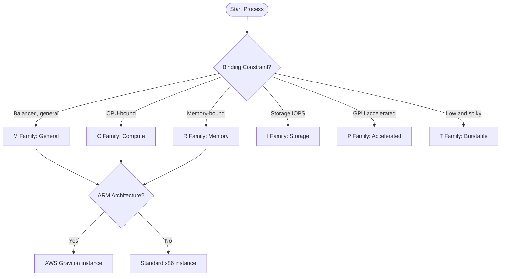

[↑ Back to plan](#Master-Plan)

---

### D02-Swimlanes-Diagram

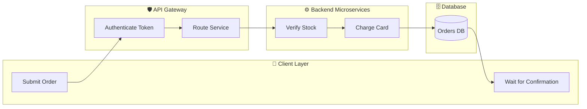

[↑ Back to plan](#Master-Plan)

---

### D03-Sequence-Diagram

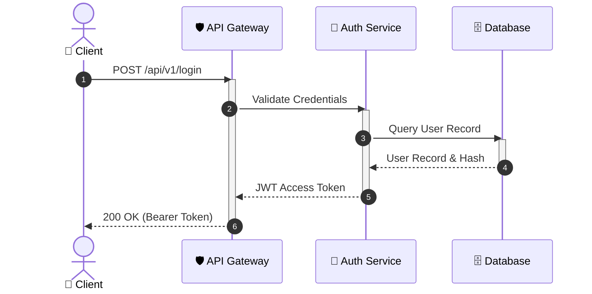

[↑ Back to plan](#Master-Plan)

---

### D04-Class-Diagram

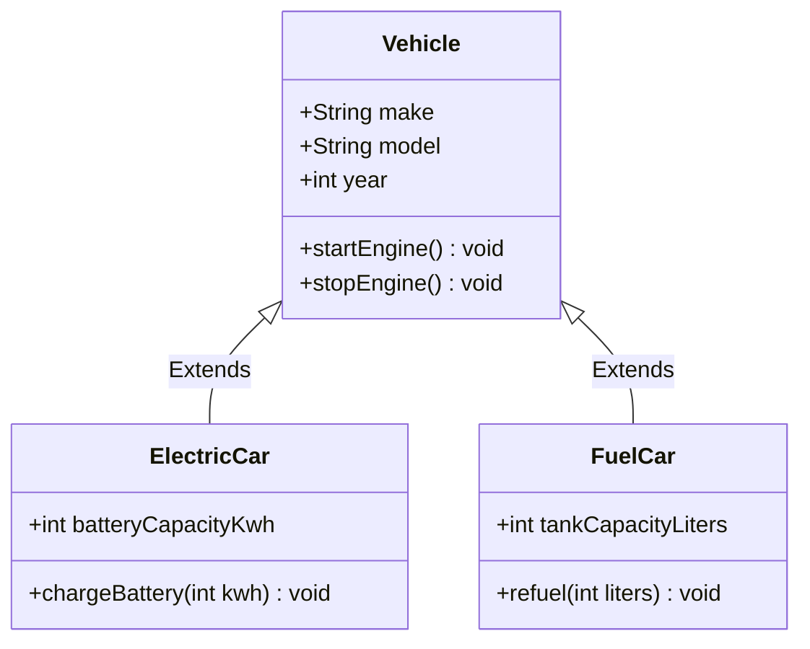

[↑ Back to plan](#Master-Plan)

---

### D05-State-Diagram

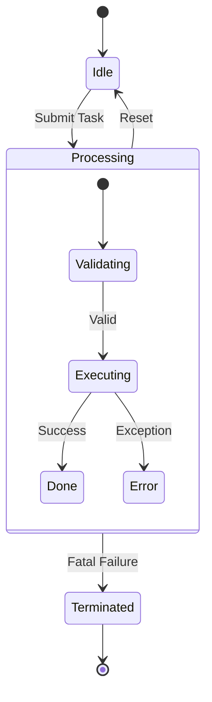

[↑ Back to plan](#Master-Plan)

---

### D06-Entity-Relationship-Diagram

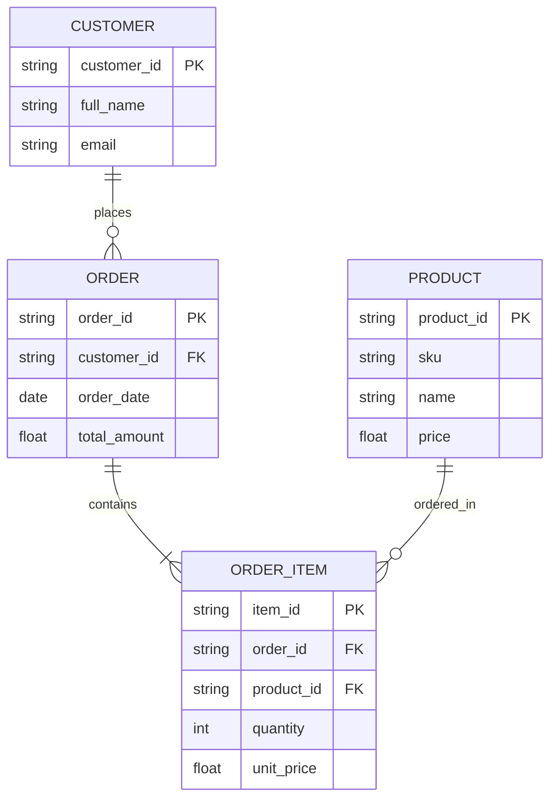

[↑ Back to plan](#Master-Plan)

---

### D07-User-Journey

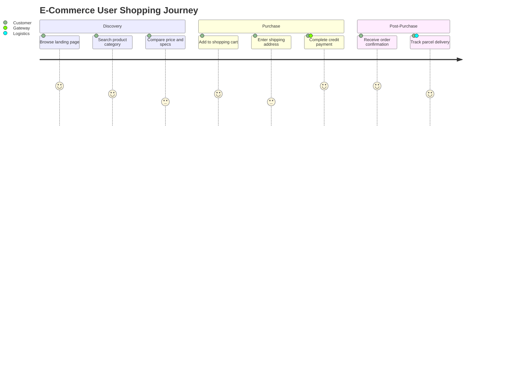

[↑ Back to plan](#Master-Plan)

---

### D08-Gantt-Chart

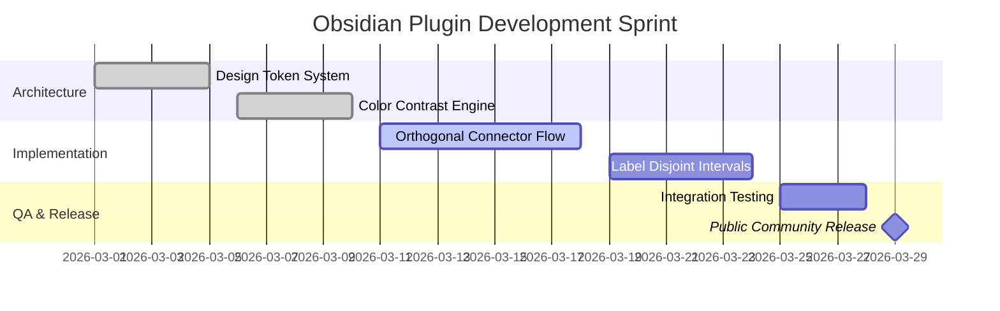

[↑ Back to plan](#Master-Plan)

---

### D09-Pie-Chart

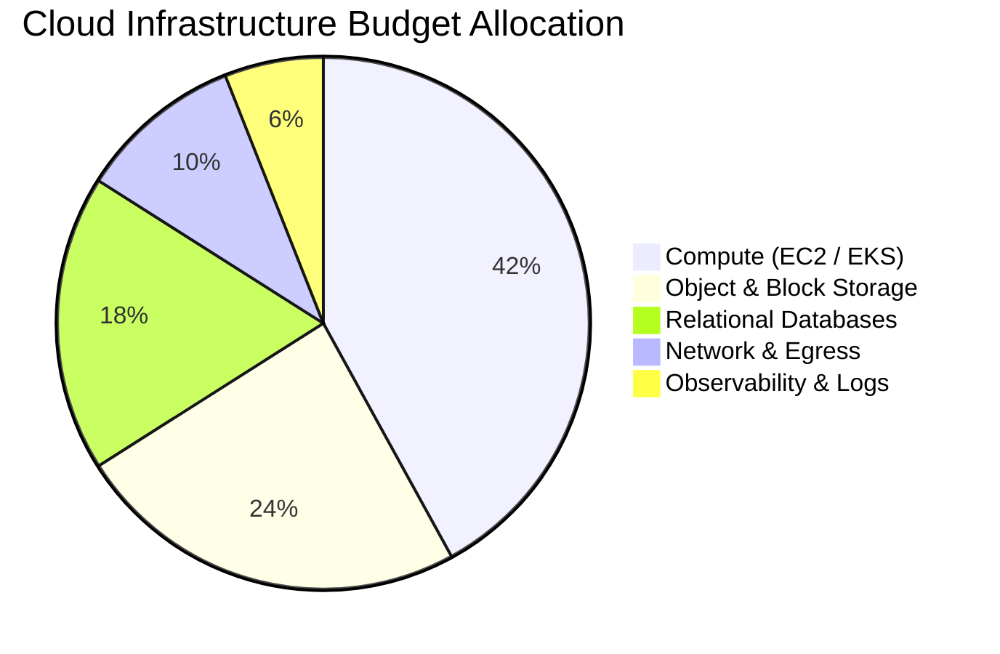

[↑ Back to plan](#Master-Plan)

---

### D10-Quadrant-Chart

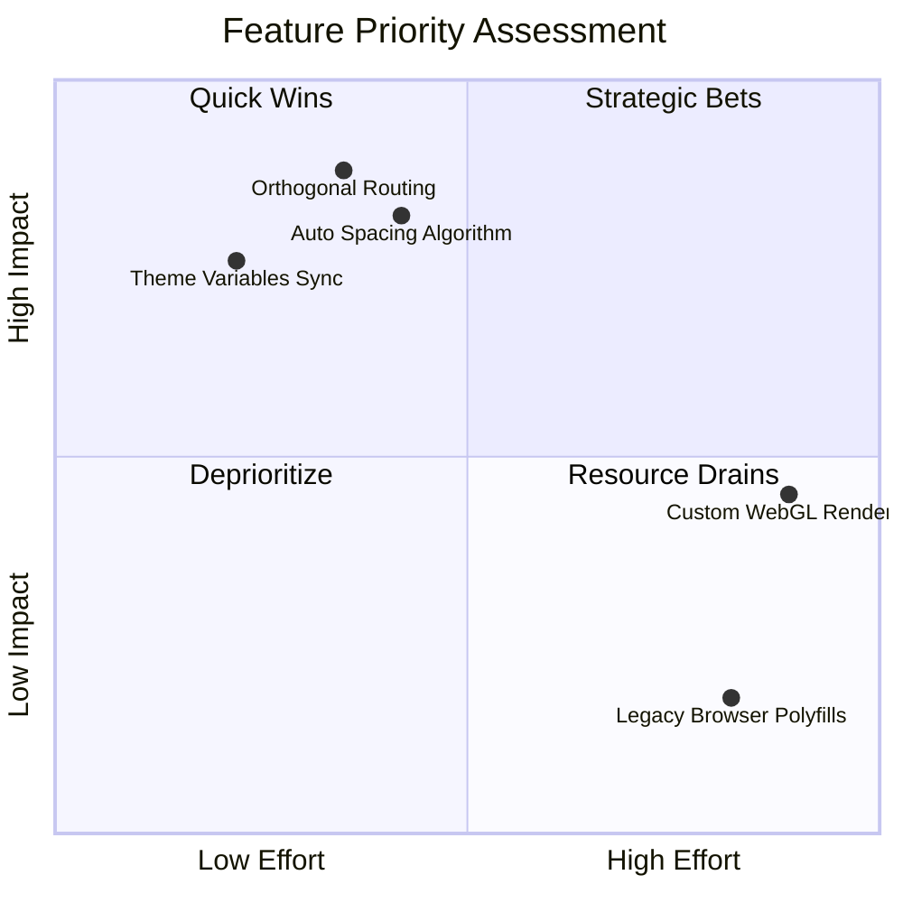

[↑ Back to plan](#Master-Plan)

---

### D11-Requirement-Diagram

```mermaid
requirementDiagram
    requirement Req_Performance {
        id: 101
        text: Render diagrams under 100ms
        risk: medium
        verifymethod: benchmark
    }
    requirement Req_Accessibility {
        id: 102
        text: Maintain WCAG AA 4.5 contrast
        risk: low
        verifymethod: automated_test
    }
    element Engine {
        type: software_module
    }
    Engine - satisfies -> Req_Performance
    Engine - satisfies -> Req_Accessibility
```

[↑ Back to plan](#Master-Plan)

---

### D12-Use-Case-Diagram

```mermaid
usecase-beta
    direction LR
    actor Author("Editor")
    actor Reader("Visitor")
    systemBoundary "Obsidian Knowledge Base"
        NoteCreation("Create & Link Notes")
        MermaidRender("Render Interactive Flowcharts")
        ExportGraph("Export SVG / PNG")
    end
    Author --> NoteCreation
    Author --> MermaidRender
    Author --> ExportGraph
    Reader --> MermaidRender
```

[↑ Back to plan](#Master-Plan)

---

### D13-GitGraph-Diagram

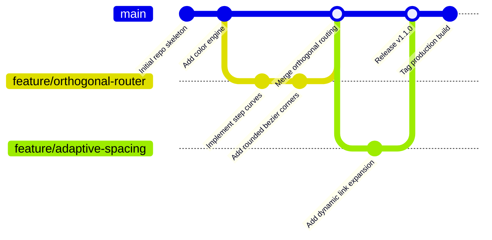

[↑ Back to plan](#Master-Plan)

---

### D14-C4-Architecture-Diagram

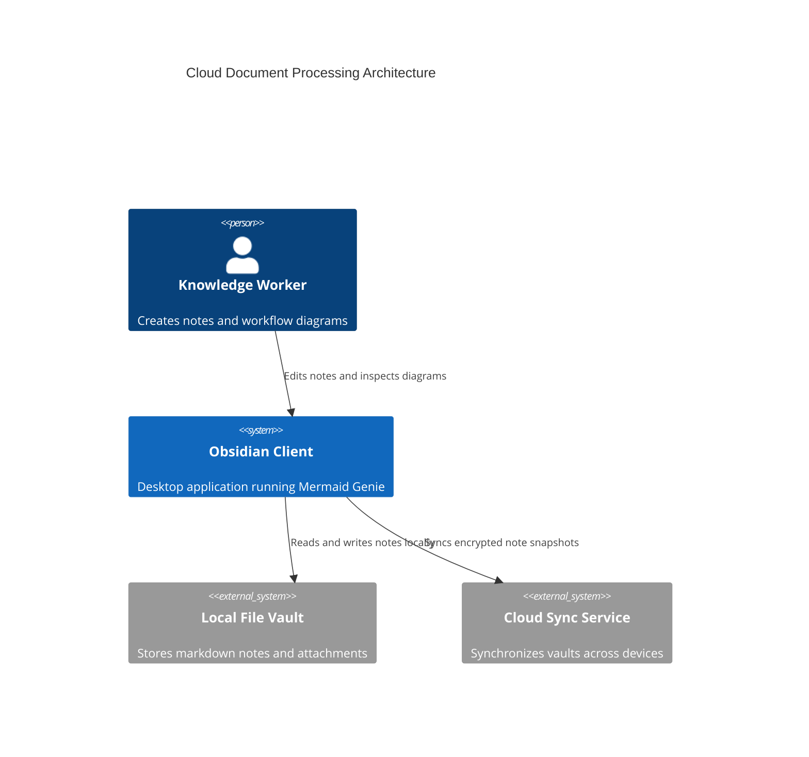

[↑ Back to plan](#Master-Plan)

---

### D15-Mindmap

```mermaid
mindmap
  root((Obsidian Mermaid Genie))
    Visual Aesthetics
      Coordinated Color Palettes
      WCAG AA Contrast Ratios
      Pill-shaped Edge Badges
    Geometry & Routing
      Orthogonal Step Connectors
      Rounded Corner Fillets
      Disjoint Branch Intervals
    Compatibility
      22 Core Diagram Types
      Dark & Light Theme Adaptability
      Obsidian Native Canvas & Live Preview
```

[↑ Back to plan](#Master-Plan)

---

### D16-Timeline

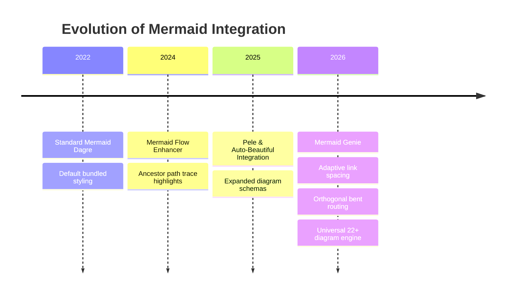

[↑ Back to plan](#Master-Plan)

---

### D17-ZenUML-Sequence

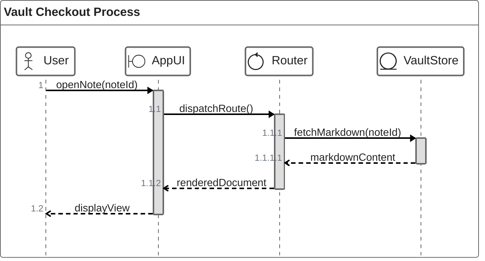

[↑ Back to plan](#Master-Plan)

---

### D18-Sankey-Diagram

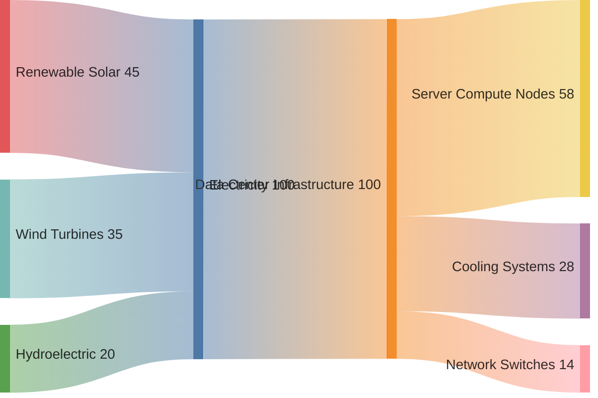

[↑ Back to plan](#Master-Plan)

---

### D19-XY-Chart

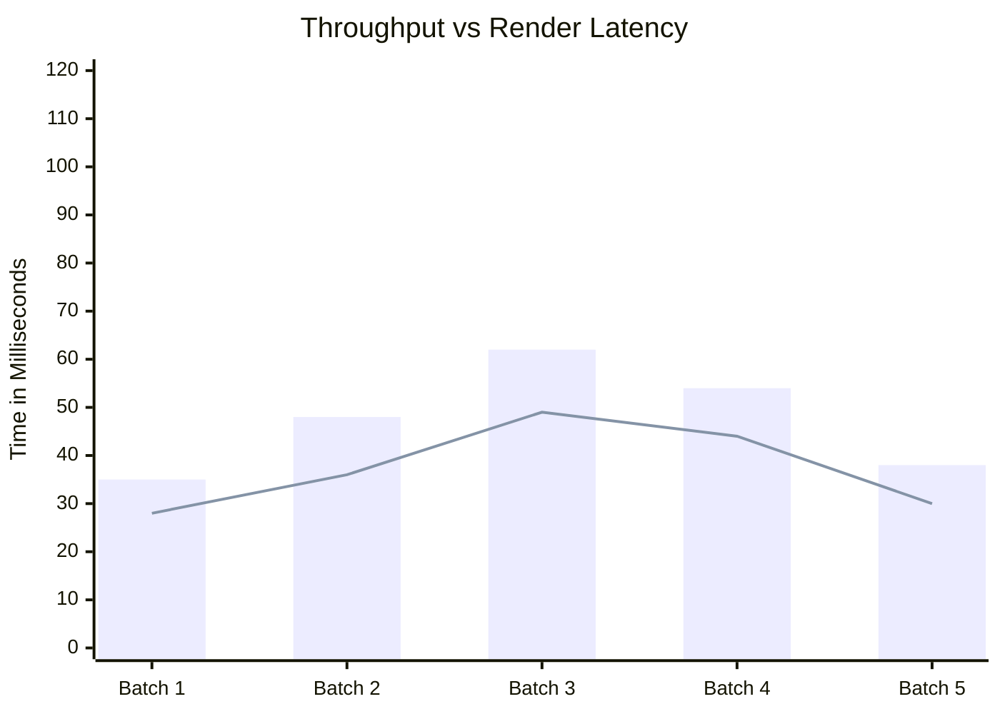

[↑ Back to plan](#Master-Plan)

---

### D20-Block-Diagram

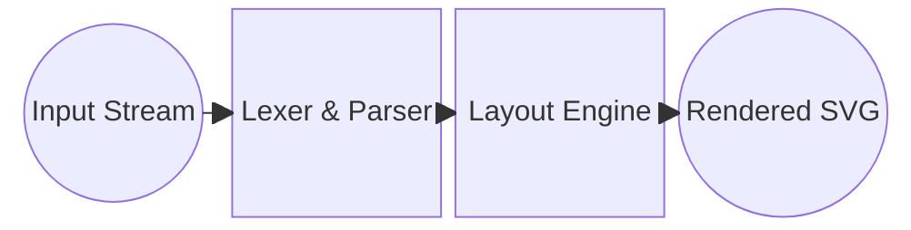

[↑ Back to plan](#Master-Plan)

---

### D21-Packet-Diagram

```mermaid
packet-beta
    0-7: "Packet Type (OpCode)"
    8-15: "Flags & Security"
    16-31: "Payload Sequence Length"
    32-63: "Originating Node Address"
    64-95: "Destination Node Address"
    96-127: "CRC32 Checksum Verification"
```

[↑ Back to plan](#Master-Plan)

---

### D22-Kanban

```mermaid
kanban
    backlog[📋 Ready for Planning]
      task1[Explore WebGL GPU acceleration]
      task2[Interactive node drag handles]
    wip[⚡ Actively in Progress]
      task3[Disjoint interval branch spacing]
      task4[Empty edge badge removal]
    review[🔍 Quality Review]
      task5[Universal schema test coverage]
    done[✅ Shipped to Production]
      task6[Orthogonal rounded step connectors]
      task7[WCAG AA Contrast verification]
```

[↑ Back to plan](#Master-Plan)

---

### D23-Architecture-Diagram

```mermaid
architecture-beta
    group cloud(cloud)[AWS Infrastructure]
    service alb(internet)[Application Load Balancer] in cloud
    service api(server)[API Cluster] in cloud
    service redis(database)[Redis Cache] in cloud
    service rds(database)[Aurora PostgreSQL] in cloud

    alb:R -- L:api
    api:B -- T:redis
    api:R -- L:rds
```

[↑ Back to plan](#Master-Plan)

---

### D24-Radar-Chart

```mermaid
radar-beta
    axis speed["Rendering Speed"], memory["Low Memory"], layout["Layout Precision"], breadth["Diagram Coverage"], a11y["Accessibility"]
    curve target["Target Spec"]{90, 85, 95, 95, 90}
    curve actual["Current Genie"]{92, 88, 96, 98, 94}
    max 100
```

[↑ Back to plan](#Master-Plan)

---

### D25-Event-Modeling

```mermaid
eventmodeling
    tf 01 ui OrderCheckoutScreen
    tf 02 cmd PlaceOrderCommand
    tf 03 evt OrderPlacedEvent
    tf 04 read OrderReadModel
```

[↑ Back to plan](#Master-Plan)

---

### D26-Treemap

```mermaid
treemap-beta
    "Repository Codebase"
      "Layout & Routing": 42
      "Palettes & Theming": 24
      "DOM & Event Controllers": 18
    "Test Suites"
      "Alignment Verification": 25
      "Color Utilities": 15
```

[↑ Back to plan](#Master-Plan)

---

### D27-Venn-Diagram

```mermaid
venn-beta
    set MarkdownAuthors["Markdown Authors"]
    set SoftwareEngineers["Software Engineers"]
    union MarkdownAuthors,SoftwareEngineers["Obsidian Power Users"]
```

[↑ Back to plan](#Master-Plan)

---

### D28-Ishikawa-Fishbone-Diagram

```mermaid
ishikawa-beta
    Visual Clipping on Nodes
    Typography
      Unconstrained text width
      Missing flex centering
    Layout Engine
      Small default nodeSpacing
      Shared midpoint connector crowding
    CSS Overrides
      ForeignObject overflow hidden
      Nested borders on subroutine shapes
```

[↑ Back to plan](#Master-Plan)

---

### D29-Wardley-Map

```mermaid
wardley-beta
    title Knowledge Graph System
    anchor User [0.95, 0.65]
    component EditorUI [0.82, 0.60]
    component GraphRenderer [0.65, 0.50]
    component MarkdownParser [0.45, 0.70]
    component FileSystem [0.20, 0.85]

    User -> EditorUI
    EditorUI -> GraphRenderer
    EditorUI -> MarkdownParser
    MarkdownParser -> FileSystem
```

[↑ Back to plan](#Master-Plan)

---

### D30-Cynefin-Framework

```mermaid
cynefin-beta
    title Engineering Problem Domains
    complex
      "Dynamic adaptive graph layout with arbitrary branching"
    complicated
      "WCAG 2.1 relative luminance color contrast calculation"
    clear
      "Mapping theme hex tokens to CSS variables"
    chaotic
      "Uncaught recursive parsing crashes in production"
```

[↑ Back to plan](#Master-Plan)

---

### D31-TreeView

```mermaid
treeView-beta
├── .obsidian/
│   ├── plugins/
│   │   └── obsidian-mermaid-genie/
│   │       ├── main.js
│   │       ├── manifest.json
│   │       └── styles.css
├── notes/
│   ├── Architecture.md
│   └── Sprints.md
└── README.md
```

[↑ Back to plan](#Master-Plan)

---

### D32-Railroad-Diagram

```mermaid
railroad-beta
    diagram = sequence(terminal("flowchart"), nonterminal("direction"), nonterminal("nodes"));
```

[↑ Back to plan](#Master-Plan)

---

### D33-AgentFlow

```mermaid
agentflow-beta TB
    flow GenieAgent["Mermaid Genie Processing Pipeline"]
      raw["Source Markdown"]@{ shape: input }
      pre["Wrap Decisions & Calc Spacing"]@{ shape: tool }
      render["Native Mermaid / Pele Render"]@{ shape: tool }
      enhance["Orthogonal Routing & Badges"]@{ shape: tool }
      out["Enhanced SVG Output"]@{ shape: output }

      raw --> pre
      pre --> render
      render --> enhance
      enhance --> out
    end
```

[↑ Back to plan](#Master-Plan)
